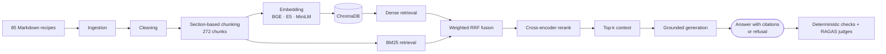

<div align="center">

# 🍳 Recipe RAG

**A layer-by-layer Retrieval-Augmented Generation pipeline over a recipe corpus — every stage inspectable, configurable, and measured.**


**Hit@1 0.53 → 0.70** with hybrid retrieval + reranking · **Citation validity 1.00** · **Refusal accuracy 0.97**

</div>

---

## Contents
- [Highlights](#-highlights)
- [Architecture](#-architecture)
- [Results](#-results)
- [Quick start](#-quick-start)
- [Configuration](#%EF%B8%8F-configuration)
- [Testing & evaluation](#-testing--evaluation)
- [Project structure](#-project-structure)

---

## ✨ Highlights

| | |
|---|---|
| 🧱 **Every layer explicit** | Ingestion → cleaning → chunking → embedding → storage → retrieval → generation, each independently testable |
| 🔀 **Swap without code changes** | Embedding model (BGE / E5 / MiniLM) and retrieval strategy (dense / BM25 / hybrid) are YAML config |
| 🎯 **Hybrid retrieval + reranking** | Weighted Reciprocal Rank Fusion of dense and BM25, then a cross-encoder reranker |
| 📎 **Grounded answers** | Citations to source sections, refusal when the corpus has no answer, basic guardrails |
| 📏 **Measured, not guessed** | Fixed 100-question golden set; deterministic checks + RAGAS LLM-as-judge |
| 🔍 **Debuggable failures** | Per-strategy CSV shows exactly what each retriever returned for every failed question |

---

## 🧭 Architecture



| Layer | What it does |
|---|---|
| Ingestion | Loads 85 Markdown recipes into a common document schema |
| Cleaning | Normalizes whitespace and line endings, preserves Markdown structure |
| Chunking | 272 parent-aware chunks split by recipe section |
| Embedding | BGE, E5 and MiniLM profiles; one Chroma cosine index per profile |
| Retrieval | `dense` · `bm25` (directly over `chunks.jsonl`) · `hybrid` (weighted RRF) + optional cross-encoder `ms-marco-MiniLM-L6-v2` |
| Generation | Configurable OpenAI-compatible model, citations, refusal behavior, guardrails |
| Evaluation | Deterministic rules + RAGAS faithfulness / relevancy / factual correctness |

Hybrid score:
```text
dense_weight / (rrf_k + dense_rank)  +  bm25_weight / (rrf_k + bm25_rank)
```

---

## 📊 Results

**Golden set:** 100 questions (88 answerable, 12 unanswerable) in `data/evaluation/golden_recipes_100_en.jsonl`. Retrieval metrics over the 88 answerable questions.

### Retrieval

| Strategy | Embedding | Dense / BM25 weights | Hit@1 | Hit@3 | Hit@5 | MRR@5 | Source Recall@5 |
|---|---|---:|---:|---:|---:|---:|---:|
| Dense | BGE Small | — | 0.5341 | 0.8068 | 0.8864 | 0.6716 | 0.8580 |
| Dense | E5 Small | — | 0.5114 | 0.8409 | 0.8523 | 0.6600 | 0.8068 |
| Hybrid | BGE Small | 1.0 / 1.0 | 0.5114 | 0.7955 | 0.8750 | 0.6538 | 0.8371 |
| Hybrid | BGE Small | 1.5 / 0.5 | 0.5682 | 0.8182 | 0.8864 | 0.6939 | 0.8390 |
| **Hybrid + reranker** | **BGE Small** | **1.5 / 0.5** | **0.7045** | **0.8977** | **0.9205** | **0.7973** | **0.9015** |

Reranking (cross-encoder over 20 candidates) wins on every metric and cuts top-one errors from 38 to 26 — at a latency cost: the 100-question CPU benchmark goes from ~22 s to ~159 s.

### End-to-end RAG

| Metric | Score |
|---|---:|
| Refusal accuracy | 0.9700 |
| Citation validity | 1.0000 |
| Citation gold precision | 0.8113 |
| Must-include recall | 0.7320 |
| Faithfulness | 0.9437 |
| Answer relevancy | 0.8906 |
| Factual correctness | 0.5810 |

Full 100-question run: ~43 minutes, no judge errors (~707 provider requests — RAGAS makes several LLM calls per case). Use `--limit 10` for routine checks.

---

## 🚀 Quick start

Requirements: Python 3.12 and Git (commands shown for Windows PowerShell).

```powershell
python -m venv .venv
.\.venv\Scripts\Activate.ps1
python -m pip install --upgrade pip setuptools
python -m pip install -e ".[dev]"              # add ",evaluation" for RAGAS judges

copy .env.example .env                          # LLM_API_KEY, LLM_BASE_URL, LLM_MODEL

# build retrieval artifacts (in order)
python .\scripts\build_processed_data.py
python .\scripts\build_chunks.py
python .\scripts\build_embeddings.py
python .\scripts\build_vector_store.py

python .\scripts\inspect_generation.py          # ask a question, get a cited answer
```

Changed only the embedding model → rerun the last two build steps. Changed only retrieval settings → no rebuild needed.
Artifacts are stored per embedding profile: `data/processed/embeddings/<profile>.jsonl`, `data/vector_store/<profile>/`.

---

## ⚙️ Configuration

<details>
<summary><b><code>configs/embedding.yaml</code> · <code>configs/retrieval.yaml</code> · <code>.env</code></b></summary>

```yaml
# configs/embedding.yaml
embedding:
  active_model: bge_small  # bge_small | e5_small | minilm
```

```yaml
# configs/retrieval.yaml
retrieval:
  strategy: hybrid         # dense | bm25 | hybrid
  final_top_k: 5
  dense_top_k: 20
  bm25_top_k: 20
  rrf_k: 60
  weights:
    dense: 1.5
    bm25: 0.5
  reranking:
    enabled: true
    model_name: cross-encoder/ms-marco-MiniLM-L6-v2
    candidate_top_k: 20
    batch_size: 32
```

```env
# .env (never committed)
LLM_API_KEY=your_api_key
LLM_BASE_URL=https://your-provider.example/v1
LLM_MODEL=your-model-name
```

Generation limits and refusal behavior: `configs/generation.yaml`. Evaluation sample size and judges: `configs/evaluation.yaml`.
</details>

---

## 🧪 Testing & evaluation

| Command | Purpose |
|---|---|
| `python -m pytest` | All automated tests |
| `python -m pytest -s .\tests\retrieval\test_retrieval_strategies.py` | Dense / BM25 / hybrid rules, independent of active config |
| `python -m pytest -s .\tests\retrieval\test_retriever.py` | Golden-set benchmark of the active strategy (writes a failure CSV) |
| `python .\scripts\inspect_retrieval.py` | Inspect one query manually |
| `python -m pytest -s .\tests\generation\test_generator.py` | Generation + guardrails with a fake client (no API calls) |
| `python .\scripts\inspect_evaluation.py --limit 10 --deterministic-only` | 10 end-to-end cases, no RAGAS judge calls |
| `python .\scripts\inspect_evaluation.py --limit 10` | Same, with RAGAS faithfulness / relevancy / factual correctness |

Failure report: `data/processed/evaluation/retrieval_errors_<strategy>_<profile>.csv` — one row per failed top-one question with expected source, first relevant rank and the five retrieved chunks.
Start with `--limit 1` when validating a new provider (RAGAS makes multiple judge calls per case).

**Testing philosophy**
- Layer tests verify correctness and data invariants; strategy tests verify retrieval rules even when another strategy is active.
- Golden-set tests measure quality and catch regressions.
- Generation and evaluation unit tests never call the real endpoint — only the `inspect_*` scripts do.

---

## 📁 Project structure

```text
configs/                     embedding · retrieval · generation · evaluation (YAML)
data/
  raw/                       source Markdown corpus (85 recipes)
  evaluation/                versioned golden dataset
  processed/, vector_store/  generated artifacts (git-ignored)
scripts/                     build_* (data → chunks → embeddings → Chroma) · inspect_* (retrieval, generation, evaluation)
src/recipe_rag/
  ingestion/ cleaning/ chunking/ embedding/ vector_store/
  retrieval/                 dense_retriever · bm25_retriever · hybrid_retriever · reranker
  generation/                grounded answers + guardrails
  evaluation/                deterministic checks + optional RAGAS judges
tests/                       evaluation/ · generation/ · retrieval/
docs/flow.md                 detailed implementation history
```
